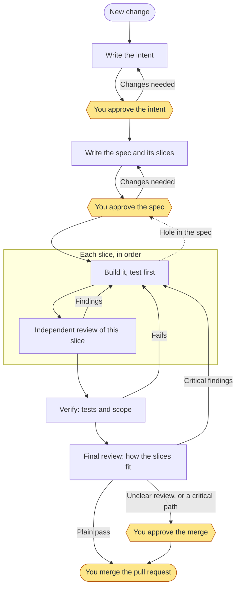
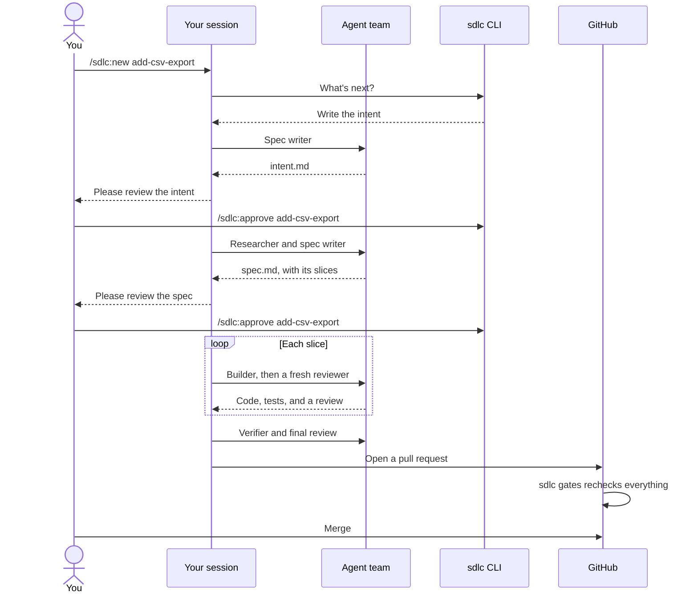
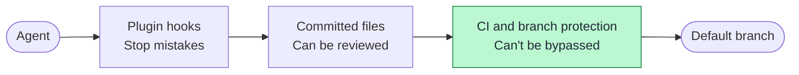

# ai-sdlc

A software factory for Claude Code. `sdlc` is a plugin that takes each change from an idea to a merged pull request through agents, tests, and review, and stops only when it needs you.

- **Git holds everything.** Specs, plans, approvals, and evidence are committed files, so work survives a closed session and leaves an audit trail.
- **Code decides what happens next, not the model.** The `sdlc` CLI runs a state machine, and agents can't skip a step by claiming it's done.
- **You stay in charge.** Only a person can approve a gate, and only a person merges.

> **Status: early.** It has shipped three real changes on one project. See [What's proven](#whats-proven) before you rely on it.

## How it works

Every change takes the same path, from a typo to a new feature. What changes is how long the documents are, not the steps.



The yellow steps are yours. Everything else runs by itself.

- **Intent** says what's wrong and what would be better. You can stop a weak idea here, before anyone spends time on a spec.
- **The spec** says exactly what will change, broken into slices. You approve the slices and the files each one may touch, so you know the scope before any code exists.
- **A slice** is a small step that can be reviewed on its own. An independent reviewer that saw none of the building checks each one, so a mistake is caught before the next slice builds on it.

Two approvals is the normal case. If a path you've marked as critical is touched, the merge and release also need your sign-off.

Inside a change, your session leads a team of agents. Each role can only do its own job: the reviewer can't edit, and the verifier can only write tests.



## Tutorial: your first change

This walks through adding a CSV export to a project. You need Claude Code, Node 20 or later, and a Git repo.

### 1. Install the plugin

From your repo:

```bash
claude plugin marketplace add shortlst-ai/ai-sdlc
claude plugin install sdlc@ai-sdlc --scope project
```

`--scope project` turns the plugin on for this repo only.

### 2. Set up the factory

Run `claude`, then:

```text
/sdlc:init
```

It finds your setup, test, and format commands, and asks which paths are critical or protected. Then commit what it created, because worktrees can't see it until you do:

```bash
git add .sdlc .claude/settings.json .gitignore
git commit -m "Adopt the software factory"
```

### 3. Turn on the CI gate

The local checks stop mistakes. This one stops everything else, because it runs where an agent can't reach it.

```bash
mkdir -p .github/workflows
curl -o .github/workflows/sdlc-gates.yml \
  https://raw.githubusercontent.com/shortlst-ai/ai-sdlc/main/plugins/sdlc/templates/sdlc-gates.yml
```

Then, in your repo's branch protection settings, make `gates` a required check on your default branch.

### 4. Start the change

Every change gets its own worktree, branch, and session. Run this in a terminal, because agent teams need one:

```bash
claude --worktree add-csv-export
```

Then, in that session:

```text
/sdlc:new add-csv-export

Let people export the orders table as CSV.
```

The session builds its own environment and writes `intent.md`: the problem, the outcome you want, and any open questions.

### 5. Approve the intent

The session stops and shows you the intent. If it's the wrong idea, stop here, because nothing else has been spent yet. Otherwise:

```text
/sdlc:approve add-csv-export
```

You can type this in any Claude session on the repo, so one window can handle all your work. Typing `/sdlc:approve` alone lists what's waiting, and `/sdlc:approve all` approves all of it.

### 6. Approve the spec

Agents research the code and write `spec.md`, including the slices:

````markdown
### S1: Add the export query

```scope
src/orders/query.py
```

### S2: Add the download button

```scope
src/orders/views.py
```
````

Each `scope` block lists what that slice may touch. Anything outside it gets refused later, so check these. If you'd change something, say so, and the session updates the spec. Then approve it the same way.

An approval is tied to the exact text you approved. If the spec changes afterward, the gate reopens.

### 7. Let it run

The session picks up by itself. For each slice, a builder writes it test-first, and a fresh reviewer checks that slice alone. The next slice doesn't start until it passes. Then your tests run, and a final review checks how the slices fit together.

If a step fails, it goes back and fixes it, up to a limit. If it hits that limit, it stops and tells you. If something turns up mid-build:

- **New work** that this change doesn't need becomes an issue, so the change stays small.
- **A hole in the spec** means the session amends the spec, which reopens that gate for you to approve.

You can check on it at any time:

```text
/sdlc:status
```

### 8. Merge

When the review passes, the session opens a pull request. Read it, check that `gates` is green, and merge it yourself.

If your repo has no remote, the session gives you a `git merge` command instead. Run it before you end the session, because removing a worktree deletes its branch and any unmerged commits.

### A smaller change

A typo fix takes the same steps, and each one is short: a line of intent, a few lines of spec, and one slice. There's no shortcut, because small changes are where assumptions go unchecked. For a bug fix, the spec says which test should fail first.

## Commands

| Command | What it does |
| --- | --- |
| `/sdlc:init` | Sets up the factory in a repo |
| `/sdlc:new <name>` | Starts a change in the current worktree |
| `/sdlc:next` | Runs the next step |
| `/sdlc:status` | Shows work items and what each one needs |
| `/sdlc:approve [name]` | Records your approval. People only |
| `/sdlc:abandon [id] <reason>` | Closes a change, keeping it on record. People only |
| `/sdlc:learn` | Turns mistakes that repeat across changes into suggested rules |
| `/sdlc:diagnose <id>` | Adds a likely cause to a CI breach |

The model can't run `approve` or `abandon`. They work only when a person types them.

## Watching CI

`sdlc-monitor.yml` checks CI on your default branch each day. If a workflow fails too often, it opens a pull request with a work item, so nobody has to notice first. Nothing gets built until you approve that item.

Copy it from `plugins/sdlc/templates/` as you did in step 3. Your CI has to run on pushes to the default branch, and you have to allow GitHub Actions to create pull requests. Detection is plain code and needs no API key. With an `ANTHROPIC_API_KEY` secret, a read-only agent also adds a likely cause.

The limits are in `.sdlc/config.json`.

## What protects your code



The first two layers keep an honest agent on track, but they run on your machine, so a determined one could get around them. **The CI check is the real boundary**, so turn it on.

## What's proven

This is new software, so here's what has and hasn't been tested.

**Tested on real work**

- Three real changes went through an earlier version on one project, with no rework
- Forged approvals and a gutted gate were both blocked on GitHub
- `/sdlc:approve` works from the terminal and the VS Code panel
- Installing from GitHub works

**Not proven yet**

- **This one-path process hasn't shipped a real change.** Those three changes used the older tracks. It has run start to finish in a real session, on a throwaway repo, in under six minutes
- **Test-first is an instruction, not a lock.** Agents are told to write the failing test first, and nothing enforces it
- **Verify evidence covers committed code.** Commit before `sdlc verify`, because uncommitted new files aren't counted
- **The deploy stage isn't built.** It's parked until there's a project to deploy, and a way to separate the agent from the approver
- **The CI monitor hasn't run on a live repo.** Its commands are tested, but the workflow itself hasn't run
- **Some attacks are only tested locally.** Deleting `.sdlc/` is refused on a fresh clone, but hasn't been tried on GitHub, and neither has a pull request that edits `sdlc-gates.yml`
- **A pull request that only changes `.sdlc/config.json` passes the gate,** so review that file whenever it changes
- **Forged approvals can pass on a solo repo.** An approval with the right hash and a made-up name passes `sdlc gates`, so on a team, pull request review is the real sign-off
- **The diagnoser isn't fully resistant to instructions planted in CI logs.** It ignored them in 7 of 8 test runs, and the eighth is unexplained

Agent teams are experimental in Claude Code and need a terminal session. In the VS Code panel, the same roles run as plain subagents.

## Develop

```bash
npm run check   # tests and plugin validation
npm run evals   # real model calls, about $1
```

- Design: [docs/proposal.md](docs/proposal.md)
- Notes from the first real runs: [docs/phase-1-notes.md](docs/phase-1-notes.md)
- Roadmap: [milestones](../../milestones)

## License

[MIT](LICENSE)
